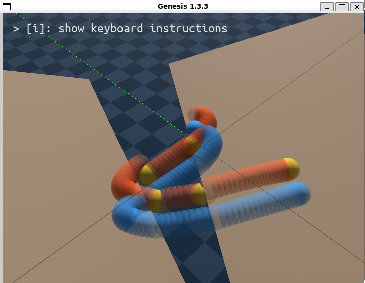
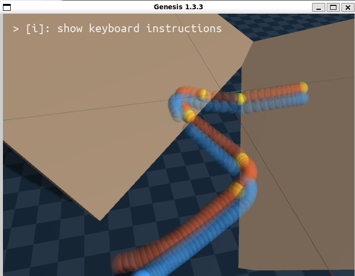

# World Models (in Simulation)

This is a personal learning project, experimenting with **world models for robotics**, starting with learning physical dynamics in simulation.

The first phase aims to train a recurrent object world model for physical interaction using the [Genesis](https://github.com/Genesis-Embodied-AI/genesis-world) physics engine.  The repo contains an interactive scene editor and command-line tools for training and evaluating a model in simulated environments. The current milestone (v1.1) successfully predicts ball motion in randomized ramp environments using a recurrent latent state-space model:

<p align="center">
  <br>
  <small>Blue path traces actual ball in simulation, orange traces blind roll-out prediction, yellow marks warm up observation period. Trajectories typically remain visually identical for a hundred or more steps (Pictured trajectories are ~1000 steps). </small>
</p>

See [the development history](docs/branches.md) for what was tested in prior iterations and the reasoning behind implemented changes.

The long-term goal is an object-centric world model that infers latent physical properties from observations and interventions, predicts outcomes in unseen scenarios, and supports goal-directed action selection and generation.   The [project plan](docs/Project%20plan.md) describes planned work in detail.


## 🛠️ Tech Stack

- Languages & Environments : Python 
- Deep Learning framework : PyTorch
- Simulation Environment: Genesis
- Deployment Environment: Local only
- Experiment tracking: local files (temporary)

## Quick Start

Install by cloning the repo and installing `requirements.txt`. Linux and WSL are preferred; other environments may or may not be supported. A fresh installation can take some time because Genesis and PyTorch with the CUDA runtime require large downloads.

To run only evaluation on the CPU, install the smaller [requirements-eval-cpu.txt](requirements-eval-cpu.txt) environment instead. The evaluation script automatically selects its CPU backend when the installed PyTorch build has no CUDA support.

Check out the latest frozen branch and run the eval script to watch a pre-trained model predict motion on a random scene: 

<code>python src/eval.py --randomize-scene --steps 800 --model artifacts/phase1.1.checkpoint.tar</code>

To train a model just run <code>python src/train.py --h</code> to list all available command line arguments or without "--h" to use sensible defaults.

## Repo Layout

```text
.
├── artifacts/                 # Images, saved models, run results, etc.
├── docs/
├── src/
│   ├── sim/                   # Sim scene construction and visualization utilities
│   ├── training/              # Dataset construction
│   ├── world_models/          # World model components
│   ├── train.py               # Model training pipeline
│   ├── editor.py              # Interactive Genesis environment editor
│   └── eval.py                # Script to visualize a trained model's performance
├── tests/
├── requirements.txt           # Python dependencies
└── README.md
```

## AI Usage
This is an experimental personal project. AI tools are used to assist in development, particularly for the visualization-related functions and tests.  However, all code is closely reviewed, and adapted by the author.
