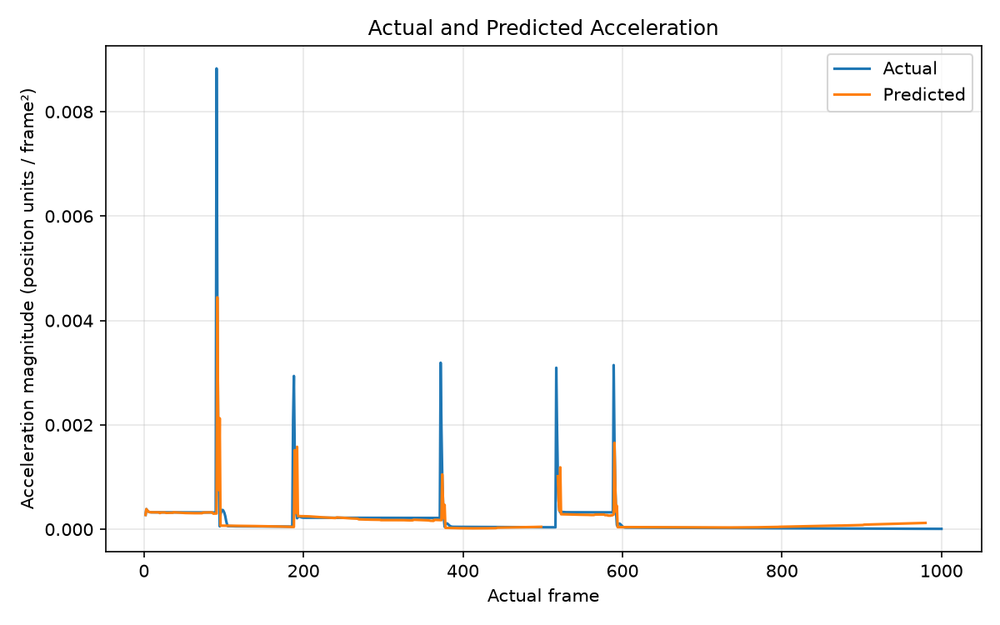

# Historical branches details

## frozen/phase-0
First functioning branch -- model learns to copy a single fixed trajectory.
Contains train/eval/editor scripts. Can create a single fixed trajectory, have the model
learn it, then demonstrate it with eval script (2 trajectory traces shown side by side)

## frozen/phase-1 
Learning latent physics (friction, inertia), also adds scalable training infrastructure.

Model is the same as phase-0 but training data contains different friction values
and directions.  Also adds multi-frame history capture to predict motion - which 
also requires a warm up period before predictions can be generated.  Scene is not randomized so model learns the specific trajectory pre-destined by the scene config.

Adds parallelized training using genesis's multiple envs support. Also refactors
scene-world relation, creating an extensible inheritance scheme and adds a new construct "builder" in addition to Scene and World to accomodate the constraints of Genesis scene construction.

## frozen/phase-1.1
This branch demonstrates learning to infer acceleration in a generalized way, with randomization of scenes preventing the model from memorizing specific trajectories (as occurred in 1.0) 

   
  <small><em>Acceleration averaged across three axes.  Spikes indicate surface transfers and are out of scope for this model.</em></small>

Major changes include: 
1) **Restructure of the world model to an encoder-updater-dynamics-decoder scheme.**
This includes moving from a no-state 5 input frame -> 1 output frame prediction to a latent state recurrent network that updates state with one frame and outputs a frame prediction.  This entails adding several new losses and the whole scheme is captured in the [Latent State Implementation Plan](designs/LATENT_STATE_IMPLEMENTATION_PLAN.md).
    Moving to this architecture was always in the plan, one of the benefits being decoupling observations from state predictions so they can be done at different schedules, but at this point it was done with the hope of helping the model to infer acceleration (it did not).

2) **Input (observation) restructure**

    **A)** Dynamics model now predicts an observation delta (displacement, added to past position), vs directly predicting next state's position.  I was concerned that tracking a 2nd order change from position was too difficult, and there is precedent in the [literature](https://arxiv.org/abs/2002.09405) to providing velocity to the model; also, the large scale difference between absolute positions and displacement likely was a barrier.

    **B)** Provide current surface details in observations, instead of static scene description in absolute coordinates.  Although the model had enough information and capacity to compute the angle of the ramp surface it is currently on, I thought this would simplify the task for the model; again, providing relative positions is an accepted approah in the literature.
    
    It is important for the long-term goal of generalizability to not introduce information the model wouldn't have once it is observing the same scene with a sufficiently capable camera (i.e. perhaps with depth perception).  Thus, the only structure added was A) diffing the frames (giving velocity instead of position sequences), defensible because it's uniform and applies to all inputs B) distance to nearest surface + normal vector of that surface (provided directly) - which a camera + basic object tracking (in  plan) could supply.  

3) **Scene and dataset construction changes**

    **A)** Randomizing scenes: having realized that the model was memorizing absolute positions, I randomized the orientation and absolute position of the scene elements (ramps and ball start position).  Additionally, I added generation of multiple trajectories in each scene with different starting points to discourage the model from excessive reliance on the scene element positions (at one point, a targeted analysis showed the model to be largely insensitive to history input, relying primarily on static features). 
    For similar reasons, I added a second ramp to the scenes, so that trajectories now have multiple phases of descent, ascent of the other ramp, reversal, and return through (almost) previously visited positions, forcing the model to pay attention to relationship of  acceleration to current motion in the context of the same ramps.

    **B)** Rollout termination: as a consequence of the switch of input state features to 'current surface' from absolute positions, an "autonomous rollout" (without observation updates), whether during training or eval, can not meaningfully continue across surface changes.  Handling this turned out to be the final piece needed for successful training, as otherwise the model acquired a bias for upward movement.  

    **C)** Dataset construction: once the latent state model was introduced, to avoid the model linking particular frame indices in the trajectory to specific outputs, I switched to using (random-start) slices of trajectories rather than whole trajectories rollouts for training.

4) **Model mechanics**
    Tracking latent state variance, individual losses and magnitudes of activations allowed pinpointing where and in which of the several used models learning was hitting a roadblock. While adding layer normalization proved ineffective, it turned out there was a mismatch in scales of layer outputs, tracable to poor initialization.  An alterate initialization scheme made a major difference.
