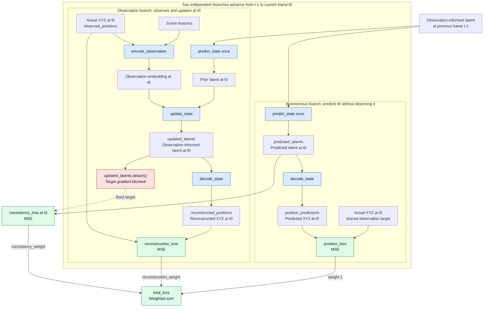

# Deterministic latent state: implementation plan

## Goal and scope

Add a persistent learned state for the single ball, using the existing XYZ observations and 10 scene features. Learn motion implicitly; use small MLPs for encoding, transition, observation updating, and decoding. Recurrence comes from carrying the latent forward, without requiring an LSTM/GRU.

Include position prediction, observation reconstruction, and detached-target latent consistency losses. Defer pixels, object interactions, stochastic latents/KL, geometric equivariance, and scheduled evaluation corrections. Preserve the existing displacement MLP as a comparison baseline.

Training entry points: `src/train.py` trains the latent-state model; `src/train_mlp.py` retains the Git version of the position-history MLP trainer for comparisons. `PositionHistoryMLP.forward()` returns absolute next positions using an internal displacement head. The older displacement/equivariance plan is not the specification for this change.

## 1. Model and state ownership

Add `src/world_models/latent_state.py`, exporting `LatentStateModel` from `src/world_models/__init__.py`. Start with independently configurable `latent_size`, `observation_embedding_size`, and `hidden_size`, each initially 64, using two hidden layers with ReLU in each MLP. These are baseline choices, not tuned settings. The updater concatenates the latent and observation embedding, so their widths need not match.

Shapes: B = batch size, T = sequence length, L = latent size, E = observation embedding size. Positions are `(B, 3)`, scene features `(B, 10)`, latents `(B, L)`, and observation embeddings `(B, E)`. The updater maps concatenated inputs `(B, L + E)` to a latent `(B, L)`.

| Operation | Inputs | Output |
| --- | --- | --- |
| `encode_observation` | Current observed position + scene features | Observation embedding |
| `update_state` | Prior latent + observation embedding | Observation-informed latent |
| `predict_state` | Current latent only | Next latent; use a learned residual update |
| `decode_state` | Latent | Absolute XYZ position |
| `forward` | Current latent only | Next position and next latent, using transition then decoder |

Scene features enter through `encode_observation` and `update_state`. The latent must retain the relevant scene geometry for autonomous prediction; neither the transition nor its `forward` wrapper receives separate scene features.

Predict_state: network generates an update that's added to prior latent to generate the next one: Let z be the current latent and f be the transition MLP:
\[
z_{\text{next}} = z + f(z)
\]
This is a simplification of a GRU - with a fixed gate of .5 (?) -- memory of prior state is carried over and just added to the update - so memory and update are 50:50.

The decoder reads position directly from the latent= The latent carries everything needed to continue - we do not bring decoded displacements back into modeling process.

Since there are no hidden units yet, through the residual update process the generated latents carry the state, so state belongs to the caller, not mutable model attributes, so training branches and different environments cannot overwrite each other. Thus the model does not track that state (latents), the caller does. Initialize a zero latent and update it with the first observation without advancing time. Thereafter, advance once to the next frame, then optionally update the latent with that frame's observation. Do not advance again when correcting a prediction already made for the same frame.

Reference architecture (mudreamer): https://arxiv.org/html/2405.15083v1#A1.SS5 - has network details

## 2. Sequence data and training

In `src/training/trajectories.py`, add a trajectory-sequence dataset using the existing stored `positions` and scene features. Preserve the split by whole trajectory and the collection/stationary cutoff behavior. Batch whole trajectories with padding, lengths, and `padding_frame_mask` (True for padding, False for observations); shuffle trajectories, not individual frames. Use a separate trajectory batch size, initially 4, rather than interpreting the existing window batch size as trajectory count.

Initially retain gradients through each full observation sequence. If this proves too costly, add ordered chunks with explicit state carry and truncated backpropagation later; never silently reset state at every five-frame window.

In `src/train.py`, add a latent-model training path:

1. Process each sequence chronologically. Predict a prior, encode the actual observation, and update the latent at every valid frame. Retain these observation-informed states with their computation graphs.
2. After the first five observations (the initial warm-up), start an independent autonomous branch from every eligible frame. Apply `predict_state` repeatedly for up to five future frames. No later observations enter that branch.
3. Decode every predicted state for position loss. Compare it with the observation-informed latent at the same future frame for consistency loss.
4. Decode observation-informed states for reconstruction loss. This provides a direct training signal to the observation encoder/updater.
5. Combine losses, backpropagate once per batch, and update parameters. Exclude padding from state updates and every loss; branches stop at trajectory boundaries. Average over valid comparisons and coordinate/latent dimensions, not padded tensor size.

For example, the branch after frame 10 predicts 11–15 without updates; the separate branch after observing frame 11 predicts 12–16. Computing targets using later observations must not mutate either branch. Do not detach branch starting states or intermediate predictions.

Keep perturbation noise disabled for the initial comparison, matching its current default. If enabled later, define a clean observation-target pass separately; do not inadvertently train consistency against corrupted targets.

## 3. Loss definitions and gradient flow

Here `position_predictions` are decoded autonomous states, `actual_positions` are their observed targets, `predicted_latents` are autonomous states, and `updated_latents` are observation-informed states at matching times. `reconstructed_positions` are decodings of observation-informed states; `observed_positions` are the corresponding actual observations. All MSEs below are masked means.

### Operations and losses at one matching frame

This simplified example predicts only one frame. The observation-informed state from the previous frame, `t-1`, is the common starting point. Both branches advance to the current frame, `t0`; the observation branch also incorporates the actual observation at `t0`. Positions are `(B, 3)` and latents are `(B, L)`.



Arrows show forward data flow; gradients travel backward through differentiable operations. The two `predict_state` boxes use the same transition weights but produce independent tensors. The dashed edge blocks only the consistency loss's target-side gradient into the `t0` observation update. Its prediction-side gradient can still reach the `t-1` starting state and the encoder/updater that created it. Reconstruction trains the observation branch and decoder; position loss trains the autonomous branch, decoder, and starting state. `forward` packages the autonomous branch's `predict_state` and `decode_state` calls; it adds no separate network.

### Operations and losses across two predicted frames

Starting from the same `t-1` state, predict both `t0` and `t1`. The autonomous branch carries its own predicted latent into the second transition; the observation branch carries its updated latent. Each frame has position, reconstruction, and consistency losses against targets at that same time. Operation boxes below include their output values to keep the diagram compact.

In other words, to compute error over a 5 step rollout from each frame, (for t1-t5 at t0), do recurrent prediction --  
	for observation branch: predict at t0 - and that goes into the update along with observation at t1
	for autonomous branch, the t0 prediction is used to then predict t1 (after state updated based on t0 delta prediction)

The branch marked "carry updated latent" saves it for the next time that PREDICTION_HORIZON frames will be generated - so that prediction serves 2 purposes.

```mermaid
flowchart TB
    start_two["Observation-informed latent<br/>at previous frame t-1"]

    subgraph branches_two["Two independent branches advance through t0 and t1"]
        direction LR

        subgraph autonomous_two["Autonomous branch: no observations at either frame"]
            direction TB
            predict_zero["predict_state<br/>→ predicted_latents at t0"]
            decode_zero["decode_state<br/>→ position_predictions at t0"]
            predict_one["predict_state<br/>→ predicted_latents at t1"]
            decode_one["decode_state<br/>→ position_predictions at t1"]
            target_zero["Actual XYZ at t0<br/>shared observation target"]
            target_one["Actual XYZ at t1<br/>shared observation target"]
            position_zero["Position MSE at t0"]
            position_one["Position MSE at t1"]

            predict_zero -->|carry predicted latent| predict_one
            predict_zero --> decode_zero --> position_zero
            predict_one --> decode_one --> position_one
            target_zero --> position_zero
            target_one --> position_one
        end

        subgraph observed_two["Observation branch: incorporates each actual frame"]
            direction TB
            scene_two["Scene features"]
            actual_zero["Actual XYZ at t0<br/>observed_positions at t0"]
            actual_one["Actual XYZ at t1<br/>observed_positions at t1"]
            prior_zero["predict_state<br/>→ prior latent at t0"]
            encode_zero["encode_observation<br/>→ observation embedding at t0"]
            update_zero["update_state<br/>→ updated_latents at t0"]
            reconstruct_zero["decode_state<br/>→ reconstructed_positions at t0"]
            reconstruction_zero["Reconstruction MSE at t0"]
            detach_zero["updated_latents at t0: detach()<br/>Target gradient blocked"]
            prior_one["predict_state<br/>→ prior latent at t1"]
            encode_one["encode_observation<br/>→ observation embedding at t1"]
            update_one["update_state<br/>→ updated_latents at t1"]
            reconstruct_one["decode_state<br/>→ reconstructed_positions at t1"]
            reconstruction_one["Reconstruction MSE at t1"]
            detach_one["updated_latents at t1: detach()<br/>Target gradient blocked"]

            prior_zero --> update_zero
            actual_zero --> encode_zero --> update_zero
            scene_two --> encode_zero
            update_zero --> reconstruct_zero --> reconstruction_zero
            actual_zero --> reconstruction_zero
            update_zero --> detach_zero
            update_zero -->|carry updated latent| prior_one --> update_one
            actual_one --> encode_one --> update_one
            scene_two --> encode_one
            update_one --> reconstruct_one --> reconstruction_one
            actual_one --> reconstruction_one
            update_one --> detach_one
        end
    end

    start_two --> predict_zero
    start_two --> prior_zero
    predict_zero --> consistency_zero["Consistency MSE at t0"]
    detach_zero -.->|fixed target at t0| consistency_zero
    predict_one --> consistency_one["Consistency MSE at t1"]
    detach_one -.->|fixed target at t1| consistency_one

    position_zero --> position_mean["position_loss<br/>Mean over valid comparisons"]
    position_one --> position_mean
    reconstruction_zero --> reconstruction_mean["reconstruction_loss<br/>Mean over valid comparisons"]
    reconstruction_one --> reconstruction_mean
    consistency_zero --> consistency_mean["consistency_loss<br/>Mean over valid comparisons"]
    consistency_one --> consistency_mean
    position_mean -->|weight 1| total_two["total_loss<br/>Weighted sum"]
    reconstruction_mean -->|reconstruction_weight| total_two
    consistency_mean -->|consistency_weight| total_two

    classDef operation fill:#dbeafe,stroke:#2563eb,color:#111827
    classDef loss fill:#dcfce7,stroke:#15803d,color:#111827
    classDef stop fill:#fee2e2,stroke:#b91c1c,color:#111827
    class predict_zero,predict_one,decode_zero,decode_one,prior_zero,prior_one,encode_zero,encode_one,update_zero,update_one,reconstruct_zero,reconstruct_one operation
    class position_zero,position_one,reconstruction_zero,reconstruction_one,consistency_zero,consistency_one,position_mean,reconstruction_mean,consistency_mean,total_two loss
    class detach_zero,detach_one stop
```



The `t1` prediction losses backpropagate through both autonomous transitions and their shared starting state. Detaching consistency targets does not detach the observation branch's state carried from `t0` to `t1`. Decoded positions are readouts only; they never feed the next transition. The repeated boxes share model weights, and all frame losses are combined before one backward pass.

```python
position_loss = mse(position_predictions, actual_positions)   -- primarily targets prediction step (gets computed from un-observation-updated autonomous branch)          
reconstruction_loss = mse(reconstructed_positions, observed_positions)   
consistency_loss = mse(predicted_latents, updated_latents.detach())      -- focuses on prediction step (if our prediction is great, the observation update will be minimal)
total_loss = position_loss + reconstruction_weight * reconstruction_loss + consistency_weight * consistency_loss
```

Start with reconstruction weight 1.0 and consistency weight 0.1, both configurable. Include a consistency-weight-zero comparison; these weights require empirical validation because latent and position scales differ.

Detach only the target use in the consistency term. The same encoder/updater still learns through reconstruction and through branch starting states. Do not run the entire observation pass under `no_grad()`. There is no KL loss or target-network/EMA copy in this first version.

Log all three losses separately, plus latent standard deviation across valid frames/batch. Stop-gradient alone does not prevent collapse, and shrinking latent scale can make consistency loss misleading; judge improvements using position errors and autonomous rollouts.

## 4. Evaluation and checkpoints

- Update `_compute_full_trajectory_rollouts` in `train.py` and `PredictionWorld` to retain caller-owned latent state. Assimilate the first five observations, then repeatedly transition/decode without observation corrections. Share the same model operations used during training; do not reinitialize from position history each step.
- Keep actual positions available only for scoring after warm-up. Preserve visualization and the existing `validation_rollouts.npz` fields/variable lengths. Use XYZ errors for model comparisons; the current viewer's `DisplacementErrorTracker` uses XY, so label/distinguish that existing diagnostic.
- Support `observe()` for future correction at the current predicted frame, but leave periodic corrections out of `eval.py` for this step.
- Use separate training entry points (`train.py` for latent state, `train_mlp.py` for the MLP) and retain checkpoint dispatch in `eval.py`. Save a distinct model type, architecture dimensions, scene-feature size, warm-up length, and format version. Record loss weights/horizon in training metadata. Preserve loading of the current `position_from_displacement` baseline; never reinterpret its weights as latent-model weights.

## 5. Verification and experiment

Add focused tests for: same-frame update versus time advancement; branch independence; padding/reset behavior across unequal trajectory lengths; consistency gradients reaching the prediction branch but not the target tensor; reconstruction gradients reaching the encoder/updater; and equal rollout outputs from training/evaluation helpers given identical warm-up observations.

Run unit tests with `pyenv activate ai`. Do not launch simulation or training without a new request. In subsequent user-run experiments, compare the displacement baseline, latent model with consistency disabled, and latent model with consistency enabled on identical trajectory splits and warm-up frames. Preserve position MSE as a separate comparable metric, and inspect full-rollout XYZ error growth rather than combined training loss alone.

## References

- [Tang et al., ICML 2023, Section 3, equation 2](https://proceedings.mlr.press/v202/tang23d/tang23d.pdf): squared latent prediction error with a stopped-gradient encoding target.
- [Gregor et al., NeurIPS 2019, Section 2, Figure 1 and Table 1](https://papers.neurips.cc/paper_files/paper/2019/file/2c048d74b3410237704eb7f93a10c9d7-Paper.pdf): observation-updated belief states and independent future prediction branches.

### Multistep autonomous rollout training

Training against several autonomous prediction steps is an established approach, though it isn't universal.

- **DreamerV3:** its world-model dynamics loss compares a one-step prior with an observation-informed posterior at each frame. It trains over sequences, with gradients through recurrent history, but this differs from supervising a five-step autonomous prediction chain. Its longer imagined rollouts train the actor and critic. [Paper](https://www.nature.com/articles/s41586-025-08744-2)
- **PlaNet's latent overshooting:** explicitly supervises multistep autonomous predictions against future observation-informed posteriors. This is the probabilistic counterpart of our proposed latent consistency rollout. [Section 4, Figure 3](https://proceedings.mlr.press/v97/hafner19a/hafner19a.pdf#page=5)
- **TD-MPC2:** provides a particularly direct deterministic example: encode the starting observation, repeatedly advance the predicted latent, and apply MSE against detached encodings of the actual future observations at each step. [Official implementation](https://github.com/nicklashansen/tdmpc2/blob/main/tdmpc2/tdmpc2.py#L238-L267)

For this model, keep the multistep horizon: it directly exposes the transition to its own accumulated errors during training. Five steps is a reasonable initial setting, but its adequacy depends on how much motion and contact evolution those five frames cover. It doesn't guarantee stability over an entire trajectory.

### How our losses connect to DreamerV3

DreamerV3's world-model objective has dynamics (`Ldyn`), representation (`Lrep`), and prediction (`Lpred`) terms. The correspondence below concerns what is compared and where gradients flow, rather than exact mathematical equivalence. See [DreamerV3, World model learning, equations 1–3](https://arxiv.org/html/2301.04104v2#S3).

| Our loss | Connection to DreamerV3 |
| --- | --- |
| `consistency_loss` | Corresponds to `Ldyn`: train a prediction made without the current observation toward a detached, observation-informed target for the same frame. Dreamer compares latent distributions using KL with a minimum threshold; we compare deterministic latent vectors using MSE. Our one-step comparison is the closest match; comparisons after multiple autonomous steps extend this into multistep consistency supervision. |
| `reconstruction_loss` | Directly corresponds to the observation reconstruction component of `Lpred`: decode the observation-informed state and compare with the actual observation. Our observations are XYZ positions. Dreamer's `Lpred` also includes reward and continuation prediction. |
| `position_loss` | Adds observation prediction supervision on autonomously predicted states: decode each predicted latent and compare with actual future XYZ. This trains the transition through its decoded predictions, including accumulated errors across the horizon. Standard DreamerV3's `Lpred` does not apply that reconstruction supervision to multistep autonomous rollouts. |

Two architectural distinctions matter. Dreamer's `Ldyn` compares distributions over its stochastic latent, conditioned on a shared deterministic hidden state; we compare the entire deterministic latent vector. Dreamer also has a separate `Lrep`, which reverses the stop-gradient placement to train the representation toward the predictor. This plan does not include that additional term.

For the two position-space losses, the key distinction is whether the decoded state has incorporated the observation at that frame: reconstruction uses the updated state; autonomous position prediction uses the uncorrected predicted state.
